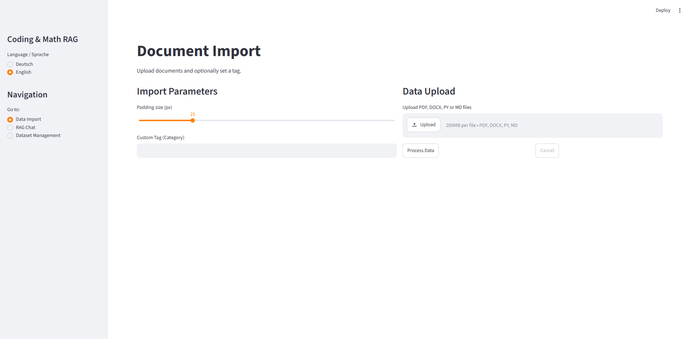

# Coding & Math RAG Pipeline

## Overview
Parsing technical documentation, scientific papers with dense mathematical notation, and complex code repositories often results in fragmented chunks and hallucinations when processed through standard Retrieval-Augmented Generation (RAG) pipelines.

The Coding & Math RAG Pipeline is a modular, multimodal Streamlit-Python application built to ingest, analyze, index, and query technical literature and codebases. The pipeline bridges the gap between unstructured text, complex LaTeX formulas, and visual figures by combining layout-aware document conversion, AST-based code parsing, visual feature extraction via a vision-language model (LLaVA), and dense vector similarity search.

The pipeline orchestrates document conversion, image extraction and deduplication, vector database indexing, VRAM management, and interactive bilingual model interaction locally through Ollama and ChromaDB.

**Privacy Notice:** No document data leaves your machine. Model weights are downloaded once on first use; all parsing, indexing, and LLM/VLM inference run entirely on your local infrastructure.

## Key Features
- **Multimodal Document Parsing:** Integrates Docling to preserve document structures, tables, and layouts across PDF files with dynamic formula-density detection via PyMuPDF.
- **AST-Based Code Splitting:** Parses Python scripts using native Abstract Syntax Trees (`ast`), isolating module headers, standalone functions, and classes/methods while preserving imports and decorators.
- **Visual Evidence Extraction:** Automatically detects, pads (adds a white border to), and deduplicates diagrams and plots, prompting LLaVA to summarize visual data alongside text chunks.
- **Hybrid Chunking & Dense Vector Indexing:** Utilizes `BAAI/bge-m3` via Sentence Transformers and ChromaDB, paired with Docling's `HybridChunker` (token-constrained) for dense semantic retrieval.
- **Strict Anti-Hallucination Prompting:** Employs configurable system prompts that instruct the model to stay within the retrieved context, handle localized responses (German/English), and distinguish text from visual image descriptions.
- **Dynamic LaTeX Normalization:** Automatically captures and converts block LaTeX expressions into Streamlit-compatible Markdown syntax without breaking code block formatting (for inline expressions, conversion is regex-based and best-effort).
- **Lifecycle & Resource Management:** Features orphan segment cleanup, automated VRAM clearing (`torch.cuda.empty_cache`), LLaVA memory unloading, file persistence, and selective or global dataset resets.

## Supported File Formats

| Format | Processing Pipeline | Formula Enrichment | Image Extraction & LLaVA | AST Symbol Splitting |
| :--- | :--- | :---: | :---: | :---: |
| **`.pdf`** | Docling Layout Engine | Yes (if density threshold met) | Yes (filtered & analyzed) | No |
| **`.docx`** | Docling Layout Engine | No | No | No |
| **`.md`** | Docling Layout Engine | No | No | No |
| **`.py`** | Custom AST Splitter | No | No | Yes (Functions, Classes, Globals) |

## Technical Stack
- **Language:** Python 3.11 (tested)
- **UI & Presentation:** `streamlit`, `Pillow`
- **Data Ingestion & Parsing:** `docling`, `docling-core`, `PyMuPDF` (`fitz`), `ast`
- **Vector Search & Embeddings:** `chromadb`, `transformers`, `sentence-transformers` (`BAAI/bge-m3`)
- **Inference & Orchestration:** `ollama` (LLMs & LLaVA), `torch`
- **Design Patterns:** Multimodal RAG, AST Syntax Parsing, Distance-Threshold Filtering, Modular Multi-View Architecture

## System Structure
The system is built on a modular, decoupled architecture that isolates document ingestion, chunking, vector management, and UI rendering to keep the code maintainable and easy to extend.

**Execution Pipeline:**
1. **Document Ingestion & Analysis:** `converter.py` evaluates PDF formula density, extracts layout structures, filters non-informative graphics, and prompts LLaVA for visual descriptions, while `vectors_storage.py` parses Python code via AST.
2. **Chunking & Indexing:** `vectors_storage.py` performs hybrid chunking (text/images) or syntax chunking (code), generates `BAAI/bge-m3` embeddings, stores original files in `static/documents/`, and writes metadata to ChromaDB.
3. **Similarity Search & Filtering:** `chat_page.py` queries ChromaDB with user inputs, applying strict vector distance thresholds defined in `config.py`.
4. **Prompt Synthesis & Generation:** `engine.py` injects retrieved context and image hints into localized prompt templates and sends the query to Ollama; `utils.py` standardizes LaTeX formatting for display.

## Folder Structure
- **main.py:** Central application entry point, managing session state, language configuration, and view routing.
- **config.py:** Global vector distance threshold constants used by the chat view for text chunk and visual image matching.
- **language.py:** Bilingual UI dictionary providing German and English string mappings.
- **utils.py:** Data formatting utilities for localized timestamps and regex-based LaTeX syntax normalization.
- **views/import_page.py:** File upload dashboard handling batch conversion, dynamic progress bars, ETA calculation, and cancellation controls.
- **views/chat_page.py:** Interactive chat interface managing message history, Ollama model parameters, retrieval filtering, and visual source rendering.
- **views/manage_page.py:** Administrative document directory for sorting, inspecting, downloading originals, and clearing the database.
- **pipeline/converter.py:** Docling conversion pipeline, formula enrichment heuristics, image filtering, LLaVA visual analysis, and VRAM purge controls.
- **rag/engine.py:** RAG engine constructing contextual system prompts, localization constraints, and Ollama chat execution.
- **rag/vectors_storage.py:** Persistent ChromaDB manager handling embedding initialization, AST code parsing, hybrid chunking, and database lifecycle.

## Configuration & Thresholds

### Vector Distance (`config.py`)
Distance metrics in ChromaDB represent cosine/L2 distance: **lower values indicate higher similarity**.
- `MAX_DIST = 0.64`: Upper distance threshold for text and code chunks. Retrieved items exceeding this value are discarded to prevent irrelevant context injection.
- `IMAGE_MAX_DIST = 0.50`: Stricter upper threshold for diagram matching. Ensures that visual figures are only shown when they strongly match the query and top source document.

### Extraction & Filtering Constants (`pipeline/converter.py`)
- `MIN_IMAGE_SIDE = 175`: Minimum width and height (in pixels). Smaller raster images are treated as icons or decorative elements and skipped.
- `SKIP_CLASSES`: Class types identified by Docling's picture classifier to discard (`logo`, `icon`, `signature`, `stamp`, `qr_code`, `bar_code`). Discarded artifacts are moved to `garbage/` for manual inspection.
- `MATH_PATTERNS`: Regex patterns used to calculate mathematical expression density over the first 16 pages of a PDF to conditionally enable compute-heavy formula enrichment.

## VRAM & Performance Considerations
- **CPU Embeddings:** `BAAI/bge-m3` runs explicitly on the CPU (`device="cpu"`) to reserve available GPU VRAM for Docling OCR and Ollama models.
- **VRAM Purging:** LLaVA is removed from VRAM immediately after image processing finishes (`keep_alive=0` and `torch.cuda.empty_cache()`), freeing GPU space before text generation models are invoked.
- **Model Sizing:**
  - `qwen2.5-coder:7b`, `qwen3:8b`, and `gemma2:9b` run comfortably on 8 GB VRAM.
  - `qwen3:14b` requires more than 8 GB VRAM for pure GPU inference; on an 8 GB card, layers will be offloaded to system RAM, which slows down generation.
- **Processing Time:** Ingesting complex, image-heavy academic PDFs (30-80 pages) with formula enrichment and LLaVA visual analysis can take up to 30 minutes on mid-tier hardware. Plain Python script imports take only a few seconds.

## Install & Usage

### 1. Prerequisites
- **Operating System:** Windows (tested); Linux (compatible); macOS (functional, but lacks CUDA GPU acceleration).
- **Hardware:** An NVIDIA GPU with at least 8 GB VRAM and 32 GB RAM is recommended for local Docling parsing and Ollama inference.
- **Ollama:** Installed and running. Pull the required models:
  ```bash
  ollama pull qwen2.5-coder:7b
  ollama pull llava
  ollama pull qwen3:8b
  ollama pull qwen3:14b
  ollama pull gemma2:9b
  ```

### 2. Setup Environment & Dependencies
Create an isolated Python 3.11 virtual environment and install PyTorch with CUDA support first:

```bash
# 1. Create and activate virtual environment
python -m venv .venv
# Windows:
.venv\Scripts\activate
# Linux/macOS:
source .venv/bin/activate

# 2. Install PyTorch with CUDA support (example: CUDA 12.4)
pip install torch torchvision --index-url https://download.pytorch.org/whl/cu124

# 3. Install remaining dependencies
pip install -r requirements.txt
```

### 3. File Organization
The following folders and files are created next to `main.py`:

```text
Coding-Math-RAG/
|--- .streamlit/
|      |--- config.toml
|--- chroma_db/
|      |--- (Persistent ChromaDB files & SQLite index)
|--- extracted_images/
|      |--- (Cropped and padded figures/diagrams)
|--- garbage/
|      |--- (Filtered/discarded visual elements)
|--- pipeline/
|      |--- converter.py
|--- rag/
|      |--- engine.py
|      |--- vectors_storage.py
|--- static/
|      |--- documents/
|             |--- (Original uploaded PDF/DOCX/PY/MD files)
|--- views/
|      |--- chat_page.py
|      |--- import_page.py
|      |--- manage_page.py
|--- config.py
|--- language.py
|--- main.py
|--- requirements.txt
|--- run.bat
|--- utils.py
```

### 4. Execution
Launch the application through the batch script or directly via Streamlit:

```bash
run.bat
# or
streamlit run main.py
```

**Workflow:**
- **Navigation:** Use the sidebar to switch between English and German, and navigate between **Data Import**, **RAG Chat**, and **Dataset Management**.
- **Data Import:** Upload individual or batch documents (`.pdf`, `.docx`, `.py`, `.md`), assign an optional tag (category), and configure visual expand padding (in pixels).
- **RAG Chat:** Select an Ollama model, configure temperature and context-window token limits (up to 16,384 tokens), and inspect context sources or embedded visual figures directly under the generated answer.
- **Dataset Management:** Inspect uploaded files, download original copies, delete specific documents, or execute a complete vector database purge.

## Known Limitations
- **Visual Accuracy:** LLaVA descriptions are generated automatically and may misinterpret complex axis scales or subtle data points. Original document text and figure captions take precedence.
- **Session-Bound Chat History:** Chat history is stored in Streamlit's `st.session_state` and is not saved to a persistent database across browser or RAG restarts.
- **Code Language Support:** AST-based code parsing is currently implemented for Python (`.py`) files only. Other code formats should be uploaded as `.md` or plain text.
- **Navigation Lock:** Application navigation is disabled during an active import run to prevent concurrent write collisions in ChromaDB.

## Troubleshooting
- **`transformers` requires PyTorch >= 2.6:** If you encounter compatibility warnings or errors with Hugging Face models, update your PyTorch wheel via the official PyTorch repository.
- **RapidOCR / ONNX Runtime CUDA Warnings:** You may see messages such as `CUDAProvider not available, falling back to CPU`. This is normal if specific optional OCR provider libraries are absent; Docling will fall back to CPU OCR automatically without breaking.
- **Ollama Connection Error:** If queries fail with an Ollama error, ensure the Ollama service is running (`ollama serve` or system service active) and that the selected model has been pulled beforehand.

## Example





**Example Retrieval Record:**
<details>
<summary>Click to expand full JSON record (Retrieved Chunk & Visual Metadata)</summary>

```json
{
    "query": "How is the acquisition function computed in the optimization loop?",
    "retrieval_metrics": {
        "text_distance_threshold": 0.64,
        "image_distance_threshold": 0.50,
        "total_chunks_retrieved": 2
    },
    "text_chunk": {
        "id": "bayesian_optimization_notes.pdf_chunk_14",
        "distance": 0.3124,
        "content": "The Expected Improvement (EI) acquisition function balances exploration and exploitation:\n$$\\alpha_{EI}(x) = (\\mu(x) - f(x^+) - \\xi)\\Phi(Z) + \\sigma(x)\\phi(Z)$$\nwhere $Z = \\frac{\\mu(x) - f(x^+) - \\xi}{\\sigma(x)}$ if $\\sigma(x) > 0$.",
        "metadata": {
            "source": "bayesian_optimization_notes.pdf",
            "page": 7,
            "type": "text",
            "tag": "Machine Learning",
            "uploaded_at": "2026-03-29T14:22:05"
        }
    },
    "visual_chunk": {
        "id": "bayesian_optimization_notes.pdf_image_2",
        "distance": 0.4218,
        "content": "Figure / diagram on page 7:\nCaption: Figure 3: Acquisition surface over search parameter space.\nAutomatic image analysis: The plot illustrates the Gaussian Process mean prediction (solid blue line) and two-standard-deviation confidence bounds. The bottom sub-plot displays the Expected Improvement acquisition peak at x = 0.62.",
        "metadata": {
            "source": "bayesian_optimization_notes.pdf",
            "page": 7,
            "type": "image",
            "image_path": "extracted_images/bayesian_optimization_notespdf_a1f9e23b/fig2_page7_a1f9e23b.png",
            "tag": "Machine Learning",
            "uploaded_at": "2026-03-29T14:22:05"
        }
    }
}
```

</details>